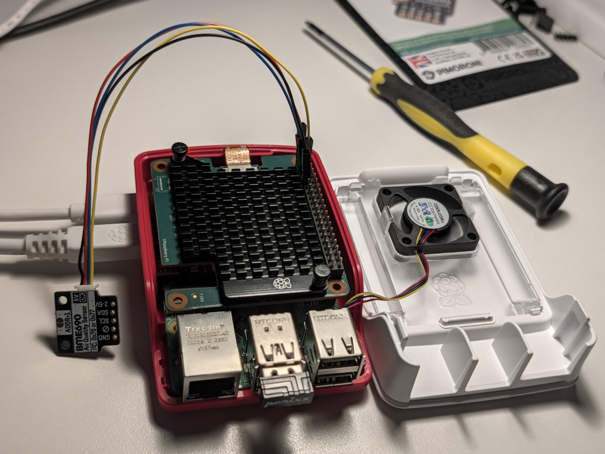
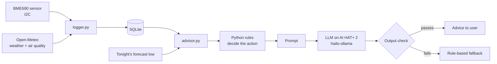

# Edge AI Air-Quality Advisor

An indoor air advisor running on a Raspberry Pi 5 with the Raspberry Pi AI HAT+
2 (Hailo-10H) and a Pimoroni BME690 sensor. It compares the air in my room with
the weather outside and tells me when opening a window will actually help, and
when it won't. It also warns about overnight condensation on the windows. The
language model runs locally on the AI HAT, so nothing leaves the house.

I also used the project to answer a question I was curious about: what can a
1.5B-parameter model on an edge accelerator do reliably, and where does it fall
short compared with a large cloud model? To find out, I built a 32-case test
suite and ran it on two on-device models and one frontier model, Claude Opus 5.5
(Medium).

<!-- Add a photo of the setup here:  -->

## Results

| Test                                               | Qwen2.5-Instruct 1.5B (on device) | DeepSeek-R1-Distill 1.5B (on device) | Claude Opus 5.5 Medium (cloud) |
| -------------------------------------------------- | --------------------------------- | ------------------------------------ | ------------------------------ |
| Overall, 32-case suite                             | 36 %                              | 34 %                                 | 97 %                           |
| Making the ventilation decision from raw data      | 29 %                              | 0 %                                  | 100 %                          |
| Writing the advice (usable after the output check) | 62 %                              | 71 %                                 | 100 %                          |
| Saying "I don't know" instead of making things up  | 92 %                              | 50 %                                 | 100 %                          |
| Response time (model already loaded)               | 5–9 s                             | 30–51 s                              | not measured                   |

What I took from this:

- The small models can't be trusted to make the decision. Qwen got it right 29 %
  of the time, which is about what you'd get by guessing one of the four
  options. So in this project the decision is made in Python, and the model only
  writes the message.
- The models often got the format wrong, and sometimes the numbers. I added an
  output check that cleans up the formatting and compares every number in the
  message against the sensor data. That took Qwen's usable messages from 24 % to
  62 %, and when a message fails the check, a plain rule-based message is shown
  instead, so a wrong number never reaches the user.
- Inference runs entirely on the Hailo-10H. While the model was generating, the
  Pi's own CPU stayed at idle power.
- A reasoning model was the wrong choice for this job. DeepSeek-R1-Distill was
  about six times slower than Qwen and often hit its output limit before giving
  an answer at all.
- 92 % humidity outside can be drier than 50 % inside, because cold air holds
  much less water. The advisor compares the actual water content (g/m³), not the
  percentages. The small models got this wrong as well.

The full write-ups are in [findings](docs/findings.md), [evaluation suite and
results](docs/eval-suite.md) and [model and power
benchmarks](docs/llm-model-benchmarks.md).

## How it works



1. `logger.py` runs as a systemd service. It reads the BME690 every minute and
   fetches outdoor weather and air quality every 15 minutes, storing both in
   SQLite. Old data is pruned automatically. I measured about 60 MB a year, and
   the database is capped at 4 GB to fit my SD card budget.
2. `advisor.py` works out the facts from the latest readings: how much water the
   air holds inside and out, how the gas reading compares with its 7-day
   baseline, and how cold the window glass will get tonight based on the
   forecast low.
3. `airlib.decide()` applies fixed rules. It suggests airing the room for stale
   air, heat, or damp, but only if the outdoor air is drier. It says to keep the
   window closed if outdoor air quality is poor, and to open it only briefly if
   it's cold out.
4. The model (Qwen2.5-Instruct 1.5B on the Hailo-10H) turns the decision and the
   reasons into one or two plain sentences.
5. `airlib.guard()` strips greetings, sign-offs and placeholders, and rejects
   the message if it contains numbers that aren't in the data or contradicts the
   decision.

## Hardware

- Raspberry Pi 5 (4 GB) running Raspberry Pi OS Bookworm
- Raspberry Pi AI HAT+ 2: Hailo-10H with 8 GB of on-board RAM, firmware 5.1.1
- Pimoroni BME690: temperature, humidity, pressure and gas (VOC) over I2C
- Display HAT Mini (planned) to show the advice on a small screen

## What's in the repo

- `basic_read.py`: a minimal sensor read, useful for checking the wiring
- `logger.py` and `env-logger.service`: the data logger and its systemd unit
- `airlib.py`: shared physics, decision rules, prompt, model client and output
  check
- `advisor.py`: the advisor itself
- `eval.py`: the 32-case test suite, for local models and a blind frontier test
- `power_log.py`: measures the Pi's power draw while a command runs
- `eval_results/`: every model output from the tests, plus the results report
- `power_logs/`: the raw power measurements
- `docs/`: findings, test method and results, model and power benchmarks

## Running it

```bash
# Sensor library (Pimoroni's installer creates ~/.virtualenvs/pimoroni)
source ~/.virtualenvs/pimoroni/bin/activate

# Logger as a service (set LAT/LON in the unit file first)
sudo cp env-logger.service /etc/systemd/system/
sudo systemctl daemon-reload
sudo systemctl enable --now env-logger

# Model server on the AI HAT+ 2, and the model
hailo-ollama &
curl -s http://localhost:8000/api/pull -d '{"model": "qwen2.5-instruct:1.5b"}'

# Advisor. GLAZING_U = window U-value:
# 5.8 single, 2.8 older double, 1.4 modern double, 0.8 triple glazing
python3 advisor.py

# Tests
python3 eval.py --model qwen2.5-instruct:1.5b --reps 3
python3 eval.py --report
```

## Limitations and next steps

- I haven't measured the AI HAT's own power yet. `hailortcli measure-power`
  isn't supported on this board, so the next step is a logging USB-C power
  meter, to get the energy per message for each model.
- The frontier results (Claude Opus 5.5, Medium) come from a single blind run in
  a fresh chat session. I plan to repeat it a couple more times.
- Outdoor conditions come from Open-Meteo's models, not a local sensor.
- The window-glass temperature is a simple steady-state estimate. In reality,
  frames and edges are colder than the middle of the glass.
- Next: show the advice on the Display HAT, and send a condensation warning
  before bedtime.
- Later: "ask your room", where you type a question like "How humid was it
  today?" and get an answer from the logged data. The model would pick one of a
  few Python query functions (for example `humidity_summary` for today), Python
  would run it on the real data, and the model would phrase the result. This
  approach is called tool calling. I tested the model's part of it, and the
  on-device models only picked the right function 29 % of the time (Qwen) and 13
  % (DeepSeek), so it isn't reliable enough yet. A likely fix is matching common
  questions with simple keyword rules and only falling back to the model for
  unusual phrasings.
